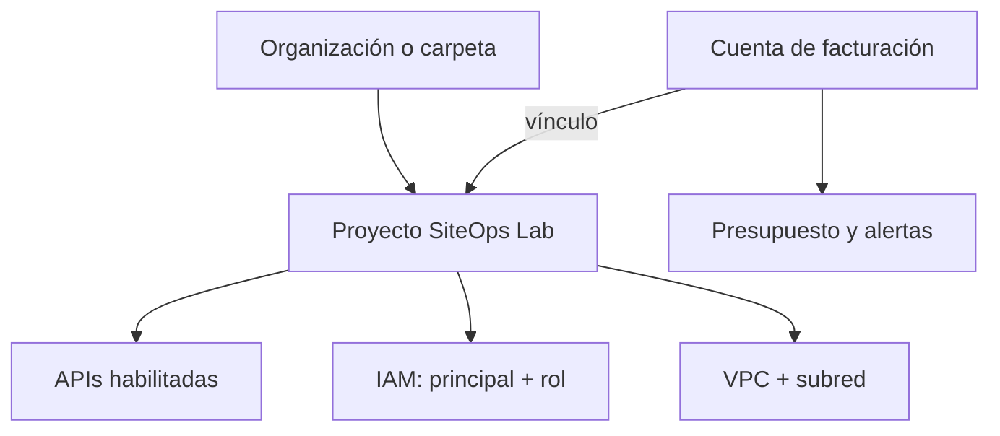

# ACE 2026 - Lección 15: Laboratorio integral de entorno: proyecto, API, permisos, costos y red

> **Fecha:** 9 de octubre de 2026  
> **Dominio de la guía ACE:** 1.1 Setting up cloud projects and accounts / 1.2 Managing billing configuration  
> **Práctica del plan:** Documenta pasos, resultados y limpieza de un entorno de laboratorio.  
> **Duración sugerida:** 90-120 minutos  
> **Caso conductor:** SiteOps Tracker, proyecto ficticio de portafolio.

Esta lección integra lo estudiado sobre proyectos, APIs, IAM, facturación y red. Recibir el archivo no demuestra dominio: la evidencia es poder explicar cada decisión, ejecutar o simular el laboratorio, comprobar el estado final y dejar constancia de la limpieza.

## 1. Objetivo

Al finalizar podrás:

1. preparar un proyecto temporal sin confundir nombre, ID y número de proyecto;
2. verificar o vincular una cuenta de facturación de forma consciente;
3. habilitar solo las APIs necesarias y comprobar su estado;
4. crear una identidad de servicio sin claves y asignarle un rol predefinido de mínimo privilegio;
5. crear una VPC de modo personalizado y una subred regional;
6. distinguir autenticación, autorización, habilitación de API, cuota y facturación;
7. establecer o simular un presupuesto **solo de alertas** para el proyecto;
8. documentar comandos, resultados, evidencias, errores y limpieza;
9. eliminar recursos en el orden correcto y demostrar que ya no existen.

### Evidencia mínima

Entrega una tabla o notas con:

- proyecto seleccionado y `projectId` comprobado;
- estado de facturación;
- APIs habilitadas;
- principal, rol y nivel donde se aplicó el binding IAM;
- nombre, región y CIDR de la subred;
- presupuesto creado o alternativa conceptual;
- comandos o pantallas de verificación;
- resultado de la limpieza.

No copies IDs reales, correos personales, secretos, tokens ni datos sensibles al compartir tus notas.

## 2. Alineación con la guía oficial ACE

La página 1 de la guía oficial ubica en la sección 1 estas tareas relevantes:

- **Creating a resource hierarchy**;
- **Granting members IAM roles within a project**;
- **Enabling APIs within projects**;
- **Setting up cloud networking**;
- **Creating one or more billing accounts**;
- **Linking projects to a billing account**;
- **Establishing billing budgets and alerts**;
- **Setting up billing exports**.

Hoy no se crea una exportación de facturación ni una carga de cómputo: se integran las piezas fundamentales del entorno y se deja un rastro verificable de configuración y limpieza.

## 3. Prerrequisitos explicados desde cero

### 3.1 Cuenta e identidad activa

Necesitas una identidad autenticada en Google Cloud. **Autenticarse** responde “¿quién eres?”. Tener sesión iniciada no garantiza poder ejecutar una acción: IAM debe autorizarla.

En Cloud Shell, Google Cloud CLI ya está instalada y normalmente usa tu sesión de Console. En una terminal local, debes instalarla e iniciar sesión antes.

### 3.2 Proyecto temporal

Un **project** es el contenedor operativo y de facturación de los recursos. Tiene tres identificadores distintos:

| Campo | Ejemplo ficticio | Propiedad importante |
|---|---|---|
| Project name | `SiteOps L15 Lab` | Visible y modificable; no identifica de forma única. |
| Project ID | `siteops-l15-a1b2` | Globalmente único e inmutable después de crearlo. |
| Project number | `123456789012` | Lo asigna Google y algunos servicios lo usan internamente. |

Usa preferentemente un proyecto temporal proporcionado por Google Skills. Si utilizas una cuenta propia, crea un proyecto aislado o selecciona uno que puedas limpiar sin afectar trabajo real.

### 3.3 Permisos

Según la ruta que uses, podrías necesitar permisos incluidos en roles como:

| Acción | Permiso o rol orientativo |
|---|---|
| Crear proyecto bajo un padre | `roles/resourcemanager.projectCreator` en la organización o carpeta. |
| Vincular facturación | Acceso al proyecto y `roles/billing.user` sobre la cuenta de facturación; la combinación exacta depende de la organización. |
| Habilitar APIs | `serviceusage.services.enable`, incluido en `roles/serviceusage.serviceUsageAdmin`. |
| Crear red y subred | Permisos de red, normalmente mediante `roles/compute.networkAdmin`. |
| Crear service account | Permisos de creación de cuentas de servicio. |
| Cambiar IAM del proyecto | `resourcemanager.projects.setIamPolicy`, por ejemplo mediante un rol administrativo de IAM del proyecto. |
| Gestionar presupuestos | Permisos de Billing Budget sobre la cuenta o permisos de presupuesto a nivel de proyecto. |

No te asignes `Owner` o `Editor` solo para “hacer que funcione”. Si falta permiso, registra el error y usa la alternativa conceptual.

### 3.4 Facturación

Una cuenta de facturación paga el uso de uno o más proyectos. **Vincular** un proyecto permite facturar servicios; no crea por sí mismo una VM ni garantiza que todo sea gratuito. Un presupuesto solo de alertas avisa, pero no detiene automáticamente el consumo.

Google Cloud también ofrece presupuestos con límite de gasto para servicios compatibles. Son una función distinta. Este laboratorio usa un presupuesto **alerts-only** porque el objetivo es practicar alertas y no bloquear servicios.

### 3.5 Conceptos de red

- **VPC network:** red virtual global del proyecto.
- **Subnet:** rango IP regional dentro de una VPC.
- **CIDR:** notación de un rango, por ejemplo `10.15.0.0/24`.
- **Region:** ubicación geográfica donde vive la subred.
- **Private Google Access:** permite que recursos sin IP externa de esa subred alcancen APIs y servicios de Google compatibles.

En esta lección no se crean VMs, reglas de acceso desde Internet, Cloud NAT, balanceadores ni bases de datos.

## 4. Modelo mental: preparar una sede antes de abrirla

Imagina que SiteOps Tracker abrirá una sede ficticia:

- el **proyecto** es el expediente legal y operativo de la sede;
- la **cuenta de facturación** es la cuenta que pagará los consumos;
- una **API habilitada** es un departamento autorizado para recibir solicitudes;
- **IAM** es la lista que dice quién puede hacer qué;
- la **VPC** es el plano privado de comunicaciones;
- la **subred** es una zona concreta del plano con direcciones disponibles;
- el **presupuesto** es una alarma financiera;
- la **limpieza** es el cierre formal: retirar accesos, destruir infraestructura temporal y verificar.

Una puerta existente no concede acceso, una credencial válida no abre todas las puertas y una alarma de gasto no desconecta automáticamente la electricidad.

## 5. Cómo encajan las piezas



El proyecto es el punto de integración. La cuenta de facturación no contiene la VPC; paga el uso del proyecto. La API no autoriza al principal; IAM lo hace. La VPC no determina quién puede modificarla; IAM lo hace.

## 6. Conceptos paso a paso

### 6.1 Paso 1: seleccionar el proyecto correcto

Antes de cualquier cambio, confirma cuenta y proyecto. Muchos errores de laboratorio ocurren porque la terminal apunta a otro proyecto.

Regla práctica:

> **Account -> project -> billing -> APIs -> IAM -> network -> evidence -> cleanup**

### 6.2 Paso 2: comprobar la facturación

Un proyecto puede existir sin facturación activa, pero muchos servicios no podrán consumir recursos facturables. La relación correcta es:

`billing account -> linked project -> billable service usage`

No es correcto decir que el proyecto “contiene” la cuenta de facturación.

### 6.3 Paso 3: habilitar el plano de control

Una API habilitada permite que el proyecto consuma el servicio correspondiente. Esto no implica que:

- el usuario tenga permisos;
- exista cuota suficiente;
- se haya creado un recurso;
- el recurso sea gratuito;
- la red permita el tráfico.

En el laboratorio se habilitan `compute.googleapis.com` para VPC y `iam.googleapis.com` para la identidad de servicio. La API `billingbudgets.googleapis.com` se habilita solo si usarás los comandos de presupuesto.

### 6.4 Paso 4: identidad y autorización mínima

Para representar un futuro proceso automatizado de SiteOps Tracker se crea `siteops-network-auditor`, sin clave descargable. Después se le concede `roles/compute.networkViewer` en el proyecto.

El binding contiene:

- **principal:** `serviceAccount:...`;
- **role:** `roles/compute.networkViewer`;
- **resource level:** proyecto;
- **condition:** ninguna para este ejercicio.

No se usa `Owner`, `Editor` ni una clave JSON. El rol elegido permite lectura de red y reduce el impacto frente a un rol de administración.

### 6.5 Paso 5: VPC personalizada

Una red **auto mode** crea subredes automáticamente en regiones. Una red **custom mode** comienza sin subredes y obliga a decidir región y CIDR. Para SiteOps Tracker se elige custom mode porque el equipo quiere un plan IP explícito y reproducible.

Diseño del laboratorio:

| Elemento | Valor ficticio | Motivo |
|---|---|---|
| VPC | `siteops-lab-vpc` | Aislamiento del entorno temporal. |
| Routing mode | `regional` | Suficiente para una sola región y sin conectividad híbrida. |
| Región | `us-central1` | Región estable para un laboratorio; en producción se evalúan latencia, residencia, costo y disponibilidad. |
| Subred | `siteops-lab-subnet` | Segmento explícito para futuros componentes. |
| CIDR | `10.15.0.0/24` | Rango privado sencillo y no solapado dentro del escenario ficticio. |
| Private Google Access | habilitado | Prepara acceso a APIs compatibles sin exigir IP externa a futuras cargas. |

No se crea una regla ingress desde `0.0.0.0/0` porque no existe una necesidad de tráfico entrante.

### 6.6 Paso 6: control de costos

El presupuesto del laboratorio debe filtrar el proyecto. Si omites el filtro, podría abarcar toda la cuenta de facturación. Los umbrales `0.50`, `0.90` y `1.00` significan 50 %, 90 % y 100 %.

Un presupuesto solo de alertas:

- observa costos reales o previstos;
- envía avisos a destinatarios configurados;
- no impide por sí mismo crear recursos;
- no sustituye cuotas, IAM, políticas de organización ni limpieza.

### 6.7 Paso 7: evidencia y limpieza

Un laboratorio no termina cuando un comando devuelve `Created`. Termina cuando:

1. verificaste el estado;
2. registraste la evidencia;
3. retiraste bindings temporales;
4. eliminaste los recursos en orden de dependencia;
5. volviste a consultar para comprobar ausencia.

## 7. SiteOps Tracker: escenario integrado

SiteOps Tracker registra sedes, activos, hallazgos, estados, responsables e historial. Su stack previsto es React + TypeScript, Node.js + TypeScript, PostgreSQL y servicios de Google Cloud.

En esta lección aún no se despliega la aplicación. Se prepara un entorno mínimo:

1. Un proyecto aislado contiene el laboratorio.
2. La cuenta de facturación hace posible consumir servicios si se necesitan.
3. Las APIs habilitadas exponen el plano de control.
4. Una service account representa un futuro colector automatizado de inventario de red.
5. `roles/compute.networkViewer` permite inspección, no modificación.
6. La VPC custom y la subred reservan un segmento para futuras cargas.
7. Un presupuesto alerts-only observa el proyecto.
8. Al terminar, se elimina todo lo temporal.

Separación conceptual:

- React no necesita permisos para administrar una VPC.
- El backend Node.js no debe usar credenciales personales.
- PostgreSQL no se crea hoy; más adelante se decidirá entre Cloud SQL, AlloyDB u otra opción según requisitos.
- Una service account sin workload asociado no genera trabajo ni tráfico por sí sola.

## 8. Glosario bilingüe

| English | Español | Significado operativo |
|---|---|---|
| Cloud environment | Entorno de nube | Conjunto de proyecto, identidad, servicios, red y controles de costo. |
| Project | Proyecto | Contenedor operativo, de IAM y de facturación para recursos. |
| Project ID | ID de proyecto | Identificador global, único e inmutable. |
| Project number | Número de proyecto | Identificador numérico generado por Google. |
| Billing account | Cuenta de facturación | Recurso que paga el consumo de proyectos vinculados. |
| Billing link | Vínculo de facturación | Asociación entre proyecto y cuenta de facturación. |
| API / service | API / servicio | Interfaz o producto que el proyecto puede habilitar y consumir. |
| Service enablement | Habilitación de servicio | Activación del servicio para consumo en un proyecto. |
| Principal | Principal | Identidad a la que se concede acceso. |
| Role | Rol | Conjunto de permisos. |
| IAM binding | Vinculación IAM | Relación entre principal, rol y condición sobre un recurso. |
| Least privilege | Mínimo privilegio | Solo los permisos necesarios durante el tiempo necesario. |
| Service account | Cuenta de servicio | Identidad para workloads o automatización, no una persona. |
| User-managed key | Clave gestionada por el usuario | Credencial de larga duración; no se crea en este laboratorio. |
| VPC network | Red VPC | Red virtual global de un proyecto. |
| Subnet | Subred | Rango IP regional dentro de una VPC. |
| CIDR range | Rango CIDR | Forma de expresar una red y su prefijo, como `/24`. |
| Region | Región | Ubicación geográfica que contiene zonas. |
| Private Google Access | Acceso privado a Google | Acceso a APIs compatibles desde recursos sin IP externa. |
| Budget | Presupuesto | Objetivo de gasto y reglas de notificación. |
| Alerts-only budget | Presupuesto solo de alertas | Advierte; no limita automáticamente el consumo. |
| Spend cap budget | Presupuesto con límite de gasto | Control distinto, disponible para servicios compatibles. |
| Quota | Cuota | Límite de consumo o tasa; no es un presupuesto. |
| Cleanup | Limpieza | Retiro verificable de configuraciones y recursos temporales. |

## 9. Decisiones de servicio y alternativas

| Decisión | Elección del laboratorio | Por qué | Por qué no la alternativa |
|---|---|---|---|
| Proyecto | Temporal y aislado | Reduce el radio de impacto y facilita la limpieza. | Un proyecto compartido puede contener recursos ajenos. |
| Entorno de práctica | Proyecto de Google Skills si existe | Tiene duración y permisos controlados. | Cuenta propia puede generar costos o afectar cuotas. |
| VPC | Custom mode | Permite elegir CIDR y región explícitamente. | Auto mode crea subredes que hoy no se necesitan. |
| Acceso de automatización | Service account sin clave | Identidad separada y auditable. | Una cuenta humana o una clave JSON no es la opción adecuada para una futura carga administrada. |
| Rol | `roles/compute.networkViewer` | Lectura de información de red. | `Owner`, `Editor` y `compute.networkAdmin` son excesivos para un auditor. |
| Presupuesto | Alerts-only filtrado al proyecto | Practica monitoreo sin bloquear servicios. | Un presupuesto de toda la cuenta mezcla otros proyectos; un spend cap es otro control. |
| Reglas de firewall | Ninguna adicional | No hay workload ni necesidad de ingreso. | Abrir SSH/HTTP a Internet introduce exposición innecesaria. |
| Limpieza | Granular o eliminación del proyecto dedicado | Permite demostrar dependencias y estado final. | Deshabilitar una API no elimina automáticamente recursos ni datos. |

### Regla de examen

Busca el requisito que determina la acción:

- “use a service” -> habilita la API;
- “can perform an action” -> IAM;
- “maximum rate or amount” -> quota;
- “who pays” -> billing link;
- “notify on spend” -> budget;
- “private address space” -> VPC/subnet;
- “remove temporary environment” -> dependency-aware cleanup.

## 10. Práctica guiada con Console y CLI

### 10.1 Reglas de seguridad

1. Usa un proyecto de Skills o uno dedicado al laboratorio.
2. No ejecutes estos pasos en producción.
3. No copies credenciales, tokens ni claves en tus notas.
4. No crees claves de service account.
5. No abras firewall ingress desde Internet.
6. Lee cada variable antes de ejecutar un comando.
7. Si un recurso ya existe, inspecciónalo; no lo dupliques.
8. Si no tienes permisos o crédito, realiza la alternativa conceptual completa.

### 10.2 Decide la ruta de proyecto

**Ruta A - Google Skills:** usa el proyecto temporal asignado. No crees otro proyecto, no cambies su facturación y respeta las instrucciones del laboratorio.

**Ruta B - cuenta propia:** crea o usa un proyecto exclusivamente temporal. La creación es opcional y requiere permisos sobre el padre.

En Console:

1. Abre **IAM & Admin > Manage resources**.
2. Selecciona la organización o carpeta correcta.
3. Si usarás la ruta B, selecciona **Create project**.
4. Usa un nombre reconocible y un Project ID globalmente único.
5. Antes de continuar, vuelve al selector y confirma el proyecto activo.

Creación opcional por CLI, solo para la ruta B:

```bash
export PROJECT_ID="siteops-l15-unique-suffix"

gcloud projects create "$PROJECT_ID" \
  --name="SiteOps L15 Lab" \
  --set-as-default
```

Si debe vivir bajo una carpeta u organización, agrega **una** de estas opciones al comando anterior: `--folder=FOLDER_ID` o `--organization=ORGANIZATION_ID`. No inventes el padre.

Si ya tienes proyecto temporal:

```bash
export PROJECT_ID="YOUR_TEMPORARY_PROJECT_ID"
gcloud config set project "$PROJECT_ID"
```

### 10.3 Preflight: cuenta y proyecto

```bash
gcloud auth list --filter=status:ACTIVE
gcloud config list
gcloud projects describe "$PROJECT_ID" \
  --format="yaml(projectId,projectNumber,name,parent,lifecycleState)"
```

Registra:

| Verificación | Resultado real |
|---|---|
| Cuenta activa | |
| Project ID | |
| Project number | |
| Parent | |
| Lifecycle state | |

Detente si el Project ID no coincide con el laboratorio.

### 10.4 Facturación: vincular solo si es necesario

En Console:

1. Abre **Billing > My projects** o la página de facturación del proyecto.
2. Comprueba si existe una cuenta vinculada.
3. En Google Skills, solo registra el estado; no cambies el vínculo.
4. En una cuenta propia, vincula únicamente una cuenta abierta que estés autorizado a usar.

CLI de inspección:

```bash
gcloud billing projects describe "$PROJECT_ID"
```

Ruta B, solo si debes vincular tu proyecto:

```bash
gcloud billing accounts list --filter="open=true"

export BILLING_ACCOUNT_ID="000000-000000-000000"

gcloud billing projects link "$PROJECT_ID" \
  --billing-account="$BILLING_ACCOUNT_ID"

gcloud billing projects describe "$PROJECT_ID"
```

Resultado esperado: `billingEnabled: true` y el nombre de la cuenta vinculada. No uses el ID de ejemplo.

### 10.5 APIs: habilitar y verificar

En Console:

1. Abre **APIs & Services > Library**.
2. Busca **Compute Engine API**.
3. Selecciona **Enable** solo en el proyecto temporal.
4. Repite con **Identity and Access Management (IAM) API** si no está habilitada.
5. Abre **APIs & Services > Enabled APIs & services** para comprobar el estado.

Por CLI puedes realizar la misma acción:

```bash
gcloud services enable \
  compute.googleapis.com \
  iam.googleapis.com \
  --project="$PROJECT_ID"

gcloud services list \
  --enabled \
  --project="$PROJECT_ID"
```

Registra las dos entradas. Habilitar la API no crea una VM.

### 10.6 IAM: service account sin claves y rol mínimo

Define valores:

```bash
export SA_NAME="siteops-network-auditor"
export SA_EMAIL="${SA_NAME}@${PROJECT_ID}.iam.gserviceaccount.com"
```

Crea la identidad:

```bash
gcloud iam service-accounts create "$SA_NAME" \
  --display-name="SiteOps network auditor" \
  --description="Temporary identity for ACE lesson 15" \
  --project="$PROJECT_ID"
```

Concede acceso de solo lectura a red:

```bash
gcloud projects add-iam-policy-binding "$PROJECT_ID" \
  --member="serviceAccount:${SA_EMAIL}" \
  --role="roles/compute.networkViewer" \
  --condition=None
```

Comprueba el binding:

```bash
gcloud projects get-iam-policy "$PROJECT_ID" \
  --flatten="bindings[].members" \
  --filter="bindings.members:serviceAccount:${SA_EMAIL}" \
  --format="table(bindings.role,bindings.members)"
```

En Console:

1. Abre **IAM & Admin > IAM**.
2. Busca la service account.
3. Confirma el rol **Compute Network Viewer**.
4. Abre **IAM & Admin > Service Accounts** y comprueba que no creaste una clave administrada por el usuario.

### 10.7 Red: crear por CLI y verificar en Console

Define el diseño:

```bash
export REGION="us-central1"
export NETWORK_NAME="siteops-lab-vpc"
export SUBNET_NAME="siteops-lab-subnet"
export SUBNET_RANGE="10.15.0.0/24"
```

Crea una VPC custom:

```bash
gcloud compute networks create "$NETWORK_NAME" \
  --subnet-mode=custom \
  --bgp-routing-mode=regional \
  --description="Temporary network for ACE lesson 15" \
  --project="$PROJECT_ID"
```

Crea la subred:

```bash
gcloud compute networks subnets create "$SUBNET_NAME" \
  --network="$NETWORK_NAME" \
  --range="$SUBNET_RANGE" \
  --region="$REGION" \
  --enable-private-ip-google-access \
  --description="SiteOps lab subnet" \
  --project="$PROJECT_ID"
```

Verifica:

```bash
gcloud compute networks describe "$NETWORK_NAME" \
  --project="$PROJECT_ID" \
  --format="yaml(name,autoCreateSubnetworks,routingConfig)"

gcloud compute networks subnets describe "$SUBNET_NAME" \
  --region="$REGION" \
  --project="$PROJECT_ID" \
  --format="yaml(name,region,ipCidrRange,privateIpGoogleAccess,network)"
```

En Console:

1. Abre **VPC network > VPC networks**.
2. Selecciona `siteops-lab-vpc`.
3. Confirma **Custom**, la subred regional y `10.15.0.0/24`.
4. Comprueba que no hay una regla de firewall creada por esta práctica.

### 10.8 Costos: presupuesto alerts-only

Si usas Google Skills o no tienes permisos sobre Billing, no crees ni cambies presupuestos: registra la alternativa conceptual de la sección 10.11.

En una cuenta propia, elige **una** ruta para crear el presupuesto, no ambas.

**Ruta Console:**

1. Abre **Billing > Budgets & alerts** con el proyecto correcto.
2. Selecciona **Create budget**.
3. Nombra el presupuesto `SiteOps L15 alerts-only`.
4. Filtra únicamente el proyecto temporal.
5. Usa un monto pequeño en la moneda de la cuenta.
6. Configura umbrales 50 %, 90 % y 100 % del gasto real.
7. Confirma que sea un presupuesto de alertas, no un límite de gasto.

**Ruta CLI:** habilita la API de presupuestos en el proyecto desde el que harás la llamada y usa la cuenta autorizada:

```bash
export BILLING_ACCOUNT_ID="000000-000000-000000"

gcloud services enable billingbudgets.googleapis.com \
  --project="$PROJECT_ID"

gcloud billing budgets create \
  --billing-account="$BILLING_ACCOUNT_ID" \
  --display-name="SiteOps L15 alerts-only" \
  --budget-amount=100 \
  --filter-projects="projects/${PROJECT_ID}" \
  --threshold-rule="percent=0.50" \
  --threshold-rule="percent=0.90" \
  --threshold-rule="percent=1.00" \
  --calendar-period=month
```

Sustituye el ID de ejemplo por el de la cuenta ya vinculada. Al omitir el código de moneda en `--budget-amount`, Google Cloud usa la moneda asociada con la cuenta. Verifica y registra el nombre completo del presupuesto:

```bash
gcloud billing budgets list \
  --billing-account="$BILLING_ACCOUNT_ID" \
  --filter='displayName="SiteOps L15 alerts-only"'
```

Advertencia: un presupuesto **alerts-only** no detiene automáticamente el gasto. Los presupuestos con spend cap son un control diferente y solo aplican a servicios compatibles.

### 10.9 Inventario final antes de limpiar

```bash
gcloud projects describe "$PROJECT_ID"
gcloud billing projects describe "$PROJECT_ID"
gcloud services list --enabled --project="$PROJECT_ID"
gcloud projects get-iam-policy "$PROJECT_ID" \
  --flatten="bindings[].members" \
  --filter="bindings.members:serviceAccount:${SA_EMAIL}" \
  --format="table(bindings.role,bindings.members)"
gcloud compute networks list --project="$PROJECT_ID"
gcloud compute networks subnets list \
  --network="$NETWORK_NAME" \
  --regions="$REGION" \
  --project="$PROJECT_ID"
```

### 10.10 Limpieza granular y verificación

No ejecutes limpieza en un proyecto compartido sin confirmar que cada recurso pertenece a esta práctica.

1. Retira el binding IAM.

```bash
gcloud projects remove-iam-policy-binding "$PROJECT_ID" \
  --member="serviceAccount:${SA_EMAIL}" \
  --role="roles/compute.networkViewer" \
  --condition=None
```

2. Elimina la service account temporal.

```bash
gcloud iam service-accounts delete "$SA_EMAIL" \
  --project="$PROJECT_ID"
```

3. Elimina primero la subred y después la VPC.

```bash
gcloud compute networks subnets delete "$SUBNET_NAME" \
  --region="$REGION" \
  --project="$PROJECT_ID"

gcloud compute networks delete "$NETWORK_NAME" \
  --project="$PROJECT_ID"
```

4. Si creaste un presupuesto exclusivamente para el laboratorio, copia su ID desde `name` y elimínalo:

```bash
export BUDGET_ID="YOUR_BUDGET_ID"

gcloud billing budgets delete "$BUDGET_ID" \
  --billing-account="$BILLING_ACCOUNT_ID"
```

5. No deshabilites APIs en un proyecto compartido. En un proyecto exclusivamente temporal, puedes deshabilitar las habilitadas por esta práctica **solo si no tienen dependencias**:

```bash
gcloud services disable \
  compute.googleapis.com \
  iam.googleapis.com \
  billingbudgets.googleapis.com \
  --project="$PROJECT_ID"
```

No uses `--force`: podría deshabilitar servicios dependientes.

Quita de este comando cualquier API que no hayas habilitado durante la práctica; por ejemplo, omite `billingbudgets.googleapis.com` si usaste solo Console y nunca la habilitaste.

6. Verifica ausencia:

```bash
gcloud iam service-accounts list \
  --project="$PROJECT_ID" \
  --filter="email:${SA_EMAIL}"

gcloud compute networks list \
  --project="$PROJECT_ID" \
  --filter="name=${NETWORK_NAME}"

gcloud compute networks subnets list \
  --project="$PROJECT_ID" \
  --filter="name=${SUBNET_NAME}"
```

Las consultas deben devolver cero filas para los tres recursos temporales.

**Alternativa de limpieza completa:** si creaste un proyecto dedicado exclusivamente al laboratorio y tienes autorización, puedes marcarlo para eliminación con `gcloud projects delete "$PROJECT_ID"`. Esta acción afecta todo el proyecto; no la uses en un proyecto de Skills ni en uno compartido.

### 10.11 Alternativa conceptual completa sin cuenta, crédito o permisos

Usa este estado inicial ficticio:

| Campo | Estado inicial |
|---|---|
| Project ID | `siteops-l15-demo` |
| Billing | No vinculada |
| APIs | `compute.googleapis.com` deshabilitada; `iam.googleapis.com` habilitada |
| Principal | No existe `siteops-network-auditor` |
| IAM | Sin binding de red |
| VPC | Solo existe `default` |
| Presupuesto | Ninguno para el proyecto |

Resuelve sin ejecutar:

1. Escribe el orden correcto de las acciones.
2. Anota el comando de cada acción.
3. Predice el resultado observable.
4. Identifica el permiso que podría bloquearla.
5. Escribe el comando inverso o acción de limpieza.

Solución conceptual esperada:

| Orden | Acción | Evidencia esperada | Limpieza |
|---:|---|---|---|
| 1 | Confirmar identidad y proyecto | Cuenta activa y `siteops-l15-demo` | Ninguna. |
| 2 | Vincular Billing | `billingEnabled: true` | Desvincular solo si el proyecto es propio y no tiene recursos. |
| 3 | Habilitar Compute API | API aparece en `services list --enabled` | Deshabilitar solo si era temporal y sin dependencias. |
| 4 | Crear service account | Email `...iam.gserviceaccount.com` | Eliminar cuenta después de retirar acceso. |
| 5 | Conceder Network Viewer | Binding principal + rol | Quitar el mismo binding y condición. |
| 6 | Crear VPC custom | `autoCreateSubnetworks: false` | Eliminar después de sus subredes. |
| 7 | Crear subred | Región, `/24` y Private Google Access | Eliminar antes de la VPC. |
| 8 | Crear presupuesto filtrado | Filtro `projects/siteops-l15-demo` | Eliminar el presupuesto por ID. |
| 9 | Documentar estado | Tabla completa con resultados | Conservar solo evidencia sin secretos. |
| 10 | Limpiar y volver a consultar | Cero recursos temporales | Fin del laboratorio. |

La alternativa es válida si justificas las decisiones y demuestras que entiendes los estados y dependencias, aunque no hayas creado recursos reales.

## 11. Resultado esperado

Antes de limpiar, debes poder demostrar:

- proyecto correcto y estado `ACTIVE`;
- facturación inspeccionada y, si procede, habilitada;
- APIs requeridas habilitadas;
- service account sin claves de usuario;
- binding `roles/compute.networkViewer` a nivel de proyecto;
- VPC custom con `autoCreateSubnetworks: false`;
- subred `10.15.0.0/24` en `us-central1` con Private Google Access;
- presupuesto alerts-only filtrado al proyecto o simulación documentada;
- ausencia de VM, IP externa, regla ingress abierta, base de datos o carga de aplicación.

Después de limpiar:

- la service account temporal no aparece;
- el binding ya no existe;
- la subred y la VPC no aparecen;
- el presupuesto temporal se eliminó si fue creado;
- las APIs solo se deshabilitaron cuando era seguro;
- el proyecto compartido o de Skills no fue eliminado.

## 12. Solución de problemas

| Síntoma | Causa probable | Diagnóstico | Corrección segura |
|---|---|---|---|
| `PERMISSION_DENIED` al crear proyecto | Falta Project Creator en el padre. | Comprueba organización/carpeta seleccionada. | Pide el rol en el padre o usa un proyecto de Skills. |
| Project ID no disponible | Los IDs son globalmente únicos. | Revisa el mensaje de creación. | Cambia el sufijo; el nombre visible puede permanecer. |
| `billingEnabled: false` | No existe vínculo válido o la cuenta está cerrada. | `gcloud billing projects describe`. | Vincula una cuenta abierta autorizada. |
| No ves cuentas de Billing | Falta acceso a la cuenta. | `gcloud billing accounts list --filter="open=true"`. | Solicita acceso; no inventes un ID. |
| API no se habilita | Falta `serviceusage.services.enable`, Billing o política organizacional. | Confirma proyecto, facturación y error exacto. | Obtén permiso o usa alternativa conceptual. |
| `SERVICE_DISABLED` después de habilitar | Propagación o proyecto incorrecto. | Repite `services list` y revisa Project ID. | Espera brevemente y reintenta la consulta, no el cambio indiscriminado. |
| Service account ya existe | El nombre ya se usó. | `gcloud iam service-accounts list`. | Reutiliza la identidad del laboratorio o elige otro nombre. |
| Binding no aparece | Principal mal formado, rol incorrecto o cambio en otro proyecto. | Consulta IAM con `get-iam-policy`. | Usa `serviceAccount:EMAIL` y el Project ID correcto. |
| Error por condiciones IAM | La política contiene bindings condicionales y no se definió condición. | Lee el mensaje y la política. | Usa `--condition=None` para este binding incondicional. |
| No se puede crear la red | Compute API deshabilitada o falta rol de red. | Comprueba API y cuenta activa. | Habilita API u obtén permisos mínimos. |
| CIDR se solapa | El rango coincide con otra subred conectada o existente. | Lista y compara rangos. | Elige un rango privado no solapado. |
| No se puede borrar la VPC | Aún contiene subredes u otros recursos. | Lista subredes, peerings, conectores y reglas asociadas. | Borra dependencias primero; no uses fuerza ciega. |
| El presupuesto abarca toda la cuenta | Se omitió filtro de proyecto. | Revisa `budgetFilter`. | Edita o recrea con `projects/PROJECT_ID`. |
| No llegan alertas inmediatamente | Aún no cruza el umbral o destinatarios sin configurar. | Revisa umbral y receptores. | Corrige la configuración; no generes gasto para “probar”. |
| Deshabilitar API no reduce costo | Recursos y datos pueden seguir existiendo. | Inventaría recursos y Billing. | Elimina los recursos facturables; luego considera la API. |

### Diagnóstico en orden

1. ¿La cuenta activa es la esperada?
2. ¿El Project ID es correcto?
3. ¿El proyecto está activo?
4. ¿Billing está vinculado cuando el servicio lo requiere?
5. ¿La API está habilitada?
6. ¿El principal tiene el permiso requerido?
7. ¿Una política de organización bloquea la acción?
8. ¿La región, CIDR y nombres son válidos?
9. ¿Existe una dependencia que impide la limpieza?

## 13. Impacto en costos y limpieza

### 13.1 Qué puede costar

- Service Usage es gratuito, pero habilitar un servicio permite facturar su uso cuando Billing está activo.
- El uso de la API de IAM es gratuito.
- Las APIs de Cloud Billing, los presupuestos y las alertas estándar son gratuitas; Pub/Sub para notificaciones programáticas puede generar cargos.
- La VPC puede implicar cargos por recursos y tráfico asociados. Revisa precios vigentes antes de añadir VMs, IP públicas, NAT, VPN, balanceadores o logging.
- Este diseño no crea compute, base de datos, almacenamiento de aplicación ni tráfico deliberado.

El costo esperado debe ser mínimo, pero no prometas costo cero: verifica el proyecto en Billing y elimina de inmediato lo temporal.

### 13.2 Qué no hacer

- No crees una VM solo para demostrar que la VPC existe.
- No generes tráfico para disparar una alerta.
- No abras `0.0.0.0/0`.
- No crees claves JSON.
- No borres el proyecto de Skills.
- No confíes en deshabilitar una API como mecanismo de eliminación de datos.

### 13.3 Lista de limpieza

- [ ] Binding IAM retirado.
- [ ] Service account temporal eliminada.
- [ ] Subred eliminada antes de la VPC.
- [ ] VPC eliminada.
- [ ] Presupuesto temporal eliminado, si se creó.
- [ ] APIs revisadas; no se usó `--force`.
- [ ] Proyecto dedicado eliminado solo si era totalmente temporal y propio.
- [ ] Billing revisado después de la práctica.
- [ ] Evidencia conservada sin secretos.

## 14. Refuerzo breve por incidencias previas

En prácticas anteriores aparecieron síntomas como SSH con timeout y un managed instance group con estado `UNHEALTHY`. La regla acumulativa es:

> **API habilitada + recurso existente no implica conectividad ni salud.**

Para un timeout de SSH, separa red, firewall, ruta/IAP, dirección, OS Login y permisos. Para un MIG no saludable, separa proceso de aplicación, puerto, ruta del health check, regla de firewall del health checker y configuración del backend. Hoy no se despliegan VMs ni MIGs; registra esta regla para las lecciones de compute.

## 15. Repaso activo espaciado

Responde sin consultar y luego compara con la guía breve.

### Día hábil anterior - Lección 14

1. ¿Cuándo puede aparecer una standalone organization?
2. ¿Workforce Identity Federation representa humanos externos o workloads?
3. ¿Autenticación concede automáticamente permisos?

Guía breve: una organización independiente puede crearse para clientes nuevos elegibles sin Cloud Identity; Workforce es para personas externas; IAM sigue determinando la autorización.

### Dos días hábiles antes - Lección 13

1. ¿Qué servicio inventaría recursos y metadatos?
2. ¿Qué plataforma reúne métricas, logs, trazas y alertas?
3. ¿Gemini Cloud Assist reemplaza la verificación humana?

Guía breve: Cloud Asset Inventory; Google Cloud Observability; no, las sugerencias deben verificarse.

### Tres días hábiles antes - Lección 12

1. ¿Una VPC es regional o global?
2. ¿Una subred es regional o zonal?
3. ¿Qué debes comprobar antes de elegir una región para un producto?

Guía breve: VPC global, subred regional, disponibilidad del producto junto con latencia, residencia y costo.

### Hace 7 días - Lección 10

1. ¿Qué relación existe entre cuenta de Billing y proyecto?
2. ¿Qué acción permite facturar el uso del proyecto?
3. ¿Quién debe tener permisos: solo el proyecto, solo la cuenta o ambos lados?

Guía breve: la cuenta paga el consumo de proyectos vinculados; el vínculo habilita facturación; la autorización puede requerir permisos en proyecto y cuenta.

### Hace 21 días - línea base previa al calendario

El plan aún no había iniciado. Recupera esta base:

1. Define proyecto, API, IAM, Billing y VPC en una oración cada uno.
2. Explica por qué ninguno de los cinco sustituye a los demás.
3. Ordena: seleccionar proyecto, habilitar API, asignar permiso, crear red, limpiar.

### Confusiones preventivas

- API habilitada no equivale a permiso IAM.
- Rol IAM no equivale a cuota.
- Cuota no equivale a presupuesto.
- Presupuesto alerts-only no equivale a freno automático.
- Deshabilitar API no equivale a borrar recursos.
- Service account no equivale a usuario humano.
- Project name no equivale a Project ID.

## 16. Ficha de práctica

| Campo | Registro del alumno |
|---|---|
| Fecha y hora | |
| Ruta usada: Skills / propia / conceptual | |
| Cuenta activa verificada | |
| Project ID | |
| Project number | |
| Billing habilitada | |
| APIs habilitadas | |
| Principal creado | |
| Rol concedido | |
| Nivel del binding | |
| VPC | |
| Subred, región y CIDR | |
| Private Google Access | |
| Presupuesto o alternativa | |
| Evidencia antes de limpiar | |
| Recursos eliminados | |
| Evidencia después de limpiar | |
| Tiempo empleado | |
| Duda principal | |

## 17. Ficha de errores

Completa una fila por error real o conceptual.

| Pregunta o paso | Mi respuesta/acción | Resultado observado | Causa raíz | Regla de decisión corregida | Cómo lo comprobaré |
|---|---|---|---|---|---|
| | | | | | |
| | | | | | |
| | | | | | |

Clasifica la causa: **concepto**, **lectura del requisito**, **comando/sintaxis**, **proyecto equivocado**, **IAM**, **Billing**, **API**, **red**, **costo** o **limpieza**.

## 18. Criterios de autoevaluación

| Criterio | Aún no | Con apoyo | Sin apoyo y con evidencia |
|---|:---:|:---:|:---:|
| Distingo project name, ID y number | ☐ | ☐ | ☐ |
| Verifico cuenta y proyecto antes de cambiar recursos | ☐ | ☐ | ☐ |
| Explico Billing link frente a budget | ☐ | ☐ | ☐ |
| Distingo API, IAM, cuota y facturación | ☐ | ☐ | ☐ |
| Elijo un rol predefinido de mínimo privilegio | ☐ | ☐ | ☐ |
| Evito claves de service account | ☐ | ☐ | ☐ |
| Explico VPC global y subnet regional | ☐ | ☐ | ☐ |
| Creo o simulo una red custom y su subred | ☐ | ☐ | ☐ |
| Documento resultados observados | ☐ | ☐ | ☐ |
| Limpio en orden y verifico ausencia | ☐ | ☐ | ☐ |

Meta personal: completa el laboratorio o la alternativa conceptual, obtiene al menos 8/10 en las preguntas y explica sin notas por qué el presupuesto de alertas no sustituye la limpieza. Es una meta de estudio, no un umbral oficial del examen.

## 19. Documentación oficial verificada

Consultada el 9 de octubre de 2026:

- [Associate Cloud Engineer certification](https://cloud.google.com/learn/certification/cloud-engineer)
- [Create and manage projects](https://docs.cloud.google.com/resource-manager/docs/creating-managing-projects)
- [`gcloud projects create`](https://docs.cloud.google.com/sdk/gcloud/reference/projects/create)
- [`gcloud projects describe`](https://docs.cloud.google.com/sdk/gcloud/reference/projects/describe)
- [`gcloud projects delete`](https://docs.cloud.google.com/sdk/gcloud/reference/projects/delete)
- [`gcloud auth list`](https://docs.cloud.google.com/sdk/gcloud/reference/auth/list)
- [`gcloud config list`](https://docs.cloud.google.com/sdk/gcloud/reference/config/list)
- [`gcloud config set`](https://docs.cloud.google.com/sdk/gcloud/reference/config/set)
- [Enable and disable services](https://docs.cloud.google.com/service-usage/docs/enable-disable)
- [Enabled services](https://docs.cloud.google.com/service-usage/docs/enabled-service)
- [Service Usage pricing](https://cloud.google.com/service-usage/pricing)
- [`gcloud services enable`](https://docs.cloud.google.com/sdk/gcloud/reference/services/enable)
- [`gcloud services list`](https://docs.cloud.google.com/sdk/gcloud/reference/services/list)
- [`gcloud services disable`](https://docs.cloud.google.com/sdk/gcloud/reference/services/disable)
- [Create service accounts](https://docs.cloud.google.com/iam/docs/service-accounts-create)
- [`gcloud iam service-accounts create`](https://docs.cloud.google.com/sdk/gcloud/reference/iam/service-accounts/create)
- [`gcloud iam service-accounts list`](https://docs.cloud.google.com/sdk/gcloud/reference/iam/service-accounts/list)
- [`gcloud iam service-accounts delete`](https://docs.cloud.google.com/sdk/gcloud/reference/iam/service-accounts/delete)
- [Compute Engine roles and permissions](https://docs.cloud.google.com/iam/docs/roles-permissions/compute)
- [`gcloud projects add-iam-policy-binding`](https://docs.cloud.google.com/sdk/gcloud/reference/projects/add-iam-policy-binding)
- [`gcloud projects get-iam-policy`](https://docs.cloud.google.com/sdk/gcloud/reference/projects/get-iam-policy)
- [`gcloud projects remove-iam-policy-binding`](https://docs.cloud.google.com/sdk/gcloud/reference/projects/remove-iam-policy-binding)
- [IAM pricing](https://cloud.google.com/iam/pricing)
- [VPC networks](https://docs.cloud.google.com/vpc/docs/vpc)
- [Subnets](https://docs.cloud.google.com/vpc/docs/subnets)
- [Create and manage VPC networks](https://docs.cloud.google.com/vpc/docs/create-modify-vpc-networks)
- [`gcloud compute networks create`](https://docs.cloud.google.com/sdk/gcloud/reference/compute/networks/create)
- [`gcloud compute networks describe`](https://docs.cloud.google.com/sdk/gcloud/reference/compute/networks/describe)
- [`gcloud compute networks list`](https://docs.cloud.google.com/sdk/gcloud/reference/compute/networks/list)
- [`gcloud compute networks delete`](https://docs.cloud.google.com/sdk/gcloud/reference/compute/networks/delete)
- [`gcloud compute networks subnets create`](https://docs.cloud.google.com/sdk/gcloud/reference/compute/networks/subnets/create)
- [`gcloud compute networks subnets describe`](https://docs.cloud.google.com/sdk/gcloud/reference/compute/networks/subnets/describe)
- [`gcloud compute networks subnets list`](https://docs.cloud.google.com/sdk/gcloud/reference/compute/networks/subnets/list)
- [`gcloud compute networks subnets delete`](https://docs.cloud.google.com/sdk/gcloud/reference/compute/networks/subnets/delete)
- [VPC pricing](https://cloud.google.com/vpc/network-pricing)
- [`gcloud billing accounts list`](https://docs.cloud.google.com/sdk/gcloud/reference/billing/accounts/list)
- [`gcloud billing projects describe`](https://docs.cloud.google.com/sdk/gcloud/reference/billing/projects/describe)
- [`gcloud billing projects link`](https://docs.cloud.google.com/sdk/gcloud/reference/billing/projects/link)
- [Create, edit, or delete budgets and alerts](https://docs.cloud.google.com/billing/docs/how-to/budgets)
- [Cloud Billing Budget API setup](https://docs.cloud.google.com/billing/docs/how-to/budget-api-setup)
- [`gcloud billing budgets create`](https://docs.cloud.google.com/sdk/gcloud/reference/billing/budgets/create)
- [`gcloud billing budgets list`](https://docs.cloud.google.com/sdk/gcloud/reference/billing/budgets/list)
- [`gcloud billing budgets delete`](https://docs.cloud.google.com/sdk/gcloud/reference/billing/budgets/delete)
- [Cloud Billing pricing](https://cloud.google.com/billing/v1/pricing)

## 20. Preguntas de examen originales

Las preguntas son inéditas, basadas en escenarios y no proceden de dumps. Responde antes de leer las soluciones.

### Question 1

An engineer needs to create a temporary Google Cloud project inside a specific folder. Which command best meets the requirement?

A. `gcloud projects create siteops-lab --folder=123456`
B. `gcloud projects create siteops-lab --billing-account=123456`
C. `gcloud folders create siteops-lab --project=123456`
D. `gcloud config set folder 123456 && gcloud services enable cloudapis.googleapis.com`

### Question 2

A project exists, but an engineer cannot create a VPC because the Compute Engine API is disabled. What should the engineer do first?

A. Grant the service account the Owner role.
B. Enable `compute.googleapis.com` in the target project.
C. Increase the CPU quota.
D. Create an alerts-only budget.

### Question 3

SiteOps Tracker needs an automated auditor that can read VPC configuration but must not change networks. Which role is the best fit?

A. `roles/owner`
B. `roles/compute.networkAdmin`
C. `roles/compute.networkViewer`
D. `roles/iam.serviceAccountAdmin`

### Question 4

An engineer creates a custom mode VPC for a new environment. What must the engineer do to provide a regional IPv4 range?

A. Create a subnet and specify its region and CIDR range.
B. Convert the VPC to an auto mode network.
C. Reserve a global external IP address.
D. Create a Cloud DNS managed zone.

### Question 5

A team creates an alerts-only budget with a 100% threshold. What happens when actual spend reaches the budget amount?

A. All project APIs are automatically disabled.
B. The billing account is automatically closed.
C. An alert can be sent, but usage is not automatically stopped.
D. All project quotas are set to zero.

### Question 6

An engineer enables an API but still receives `PERMISSION_DENIED` when creating a resource. What is the most likely explanation?

A. API enablement and IAM authorization are separate controls.
B. Enabling an API always removes IAM bindings.
C. The project name must match the billing account name.
D. The project needs an auto mode VPC for every API.

### Question 7

An engineer tries to delete a custom VPC, but Google Cloud reports that the network is still in use. The VPC contains a subnet created for the lab. What should the engineer do?

A. Disable the Service Usage API with `--force`.
B. Delete the subnet first, then delete the VPC.
C. Remove the billing link before deleting the subnet.
D. Grant the network Viewer role to the active user.

### Question 8

A temporary service account no longer needs `roles/compute.networkViewer`. Which action follows least privilege and supports clean teardown?

A. Leave the binding because the role is read-only.
B. Delete the project IAM policy.
C. Remove the exact principal-role binding, then delete the temporary service account.
D. Create a user-managed key before deleting the account.

### Question 9

A team disables a storage-related API but continues to see storage costs. What should the team conclude?

A. Disabling an API always deletes all data after one hour.
B. Existing resources or data can remain and must be inventoried and deleted separately.
C. The budget threshold must be lowered to zero.
D. The project must be renamed to stop billing.

### Question 10

Which evidence set best proves that an environment lab was completed and cleaned up?

A. A screenshot of the project name only.
B. A list of intended commands without observed output.
C. Before-and-after checks for project, billing, APIs, IAM, network resources, and cleanup results.
D. A successful login to Google Cloud Console.

## 21. Soluciones justificadas

### 1. Correct answer: A

**Why:** `gcloud projects create PROJECT_ID --folder=FOLDER_ID` creates the project under the specified folder.

- **B is wrong:** `gcloud projects create` does not use `--billing-account`; billing is linked separately.
- **C is wrong:** It attempts to create a folder, not a project, and the arguments are incorrect for the requirement.
- **D is wrong:** Setting configuration and enabling an API does not create a project under a folder.

### 2. Correct answer: B

**Why:** VPC operations use the Compute Engine API, so `compute.googleapis.com` must be enabled in the target project.

- **A is wrong:** Owner is excessive and does not replace service enablement.
- **C is wrong:** CPU quota is unrelated to enabling the API or creating a VPC object.
- **D is wrong:** A budget controls notifications, not API availability.

### 3. Correct answer: C

**Why:** Compute Network Viewer provides read-only access to network information and follows least privilege for an auditor.

- **A is wrong:** Owner grants broad administration across the project.
- **B is wrong:** Network Admin can modify network resources.
- **D is wrong:** Service Account Admin manages service accounts; it is not the network-reading role.

### 4. Correct answer: A

**Why:** A custom mode VPC starts without automatically created subnets. The engineer must create a regional subnet and define its CIDR range.

- **B is wrong:** Converting to auto mode gives up the explicit custom subnet design and is not the required action.
- **C is wrong:** An external IP does not provide a subnet address range.
- **D is wrong:** Cloud DNS manages names, not subnet CIDRs.

### 5. Correct answer: C

**Why:** An alerts-only budget can trigger a notification at the threshold but does not automatically stop usage or spending.

- **A is wrong:** APIs are not automatically disabled by an alerts-only budget.
- **B is wrong:** The billing account remains open.
- **D is wrong:** Budget thresholds do not rewrite service quotas.

### 6. Correct answer: A

**Why:** Service enablement lets the project consume a service; IAM separately determines whether the principal may perform the requested action.

- **B is wrong:** Enabling a service does not remove IAM bindings.
- **C is wrong:** Project and billing account display names do not need to match.
- **D is wrong:** APIs do not universally require an auto mode VPC.

### 7. Correct answer: B

**Why:** A VPC cannot be deleted while dependent resources such as subnets remain. Delete the subnet, then the network.

- **A is wrong:** Forcing service disablement can affect dependencies and does not remove the subnet correctly.
- **C is wrong:** Billing linkage is not the dependency preventing network deletion.
- **D is wrong:** Viewer is read-only and does not remove the dependency.

### 8. Correct answer: C

**Why:** Remove the exact binding that is no longer needed and then remove the temporary identity. This reduces standing access and leaves a clear teardown trail.

- **A is wrong:** Read-only access is still access and should not remain without a requirement.
- **B is wrong:** Deleting or replacing the entire IAM policy can remove unrelated access.
- **D is wrong:** Creating a long-lived key increases risk and is unnecessary.

### 9. Correct answer: B

**Why:** Disabling an API can block new calls, but it does not guarantee deletion of stored data or every billable resource. Inventory and delete the actual resources.

- **A is wrong:** There is no general automatic one-hour deletion behavior.
- **C is wrong:** A budget alert does not delete resources or erase charges.
- **D is wrong:** Renaming a project does not stop consumption or billing.

### 10. Correct answer: C

**Why:** Before-and-after evidence proves the selected project, relevant configuration, resource state and cleanup outcome.

- **A is wrong:** A project name alone neither identifies the environment uniquely nor proves configuration.
- **B is wrong:** Intended commands do not prove execution or observed state.
- **D is wrong:** Authentication proves identity, not completion of the lab.
